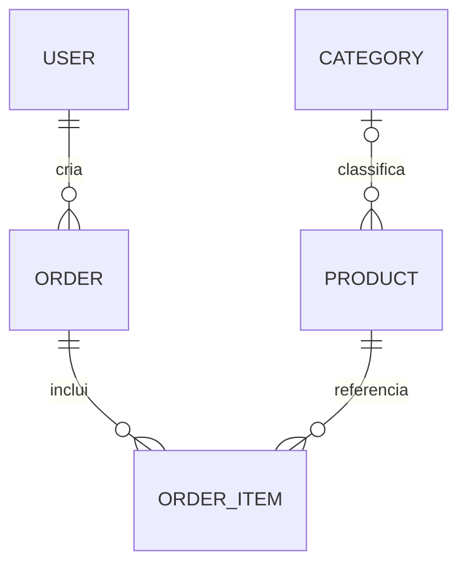

# Banco de dados do e-commerce

O [schema Prisma](../backend/prisma/schema.prisma) usa SQLite. A variável `DATABASE_URL` escolhe a conexão. Os exemplos de ambiente do projeto descrevem a configuração local.

| Entidade | Decisão de modelagem |
| --- | --- |
| `User` | Email único e versão do token para controle de sessão. |
| `Category` | Nome e slug únicos. A relação com produto é opcional. |
| `Product` | Slug único. Preço em centavos, estoque inteiro e indicador de disponibilidade. |
| `Order` | Vinculado ao usuário. O índice combina usuário e data de criação. |
| `OrderItem` | Guarda quantidade e preço unitário em centavos do momento da compra. Tem índices por pedido e produto. |

Em [orders.ts](../backend/src/routes/orders.ts), o backend valida os itens, consulta os produtos ativos e decrementa o estoque com uma condição de quantidade disponível. O cálculo usa o preço armazenado. A reserva e a criação do pedido e dos itens ocorrem na mesma transação. Estoque insuficiente retorna HTTP 409. O pedido novo usa o estado `PENDING`.

As [migrações](../backend/prisma/migrations) versionam o esquema. Para estudar a consistência, acompanhe as expectativas em [checkout.test.ts](../backend/tests/checkout.test.ts), incluindo o comportamento após erro durante o pedido.
