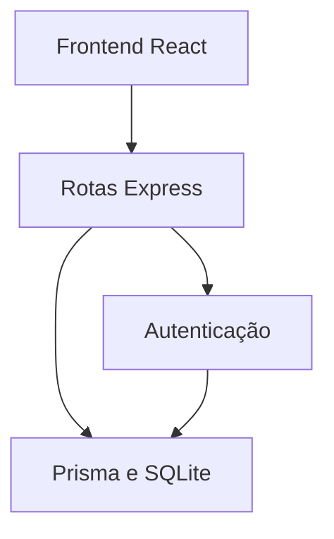

# Engenharia reversa e estudo — Minha Loja — E-commerce Full Stack

## Objetivo e fluxo

Catálogo, carrinho e criação de pedidos no comércio eletrônico. backend/src/app.ts monta o Express. As rotas consomem a autenticação e o Prisma. Compare o schema de pedidos com a forma como o frontend exibe carrinho e catálogo.

**Tecnologias identificadas** · TypeScript, SQL, React, Vite, Prisma, Express, Node.js.

**Revisão de referência** · `c13ef318b1e9`.

## Mapa do código

| Caminho | Papel de leitura | Símbolos selecionados |
| --- | --- | --- |
| [backend/prisma/migrations/0001_init/migration.sql](../backend/prisma/migrations/0001_init/migration.sql) | Script de persistência ou exemplo SQL | — |
| [backend/prisma/migrations/20261127140000_add_user_token_version/migration.sql](../backend/prisma/migrations/20261127140000_add_user_token_version/migration.sql) | Script de persistência ou exemplo SQL | — |
| [backend/prisma/seed.ts](../backend/prisma/seed.ts) | Implementação | `main` |
| [backend/src/app.ts](../backend/src/app.ts) | Ponto de leitura para entrada ou composição | `createApp` |
| [backend/src/config.ts](../backend/src/config.ts) | Implementação | — |
| [backend/src/lib/prisma.ts](../backend/src/lib/prisma.ts) | Implementação | `resolveSqliteUrl` |
| [backend/src/middleware/auth.ts](../backend/src/middleware/auth.ts) | Implementação | `signToken`, `requireAuth` |
| [backend/src/middleware/errors.ts](../backend/src/middleware/errors.ts) | Implementação | `HttpError`, `notFound`, `errorHandler` |
| [backend/src/routes/auth.ts](../backend/src/routes/auth.ts) | Implementação | `passwordMaterial`, `hashPassword`, `verifyPassword`, `startSession`, `sameOrigin` |
| [backend/src/routes/orders.ts](../backend/src/routes/orders.ts) | Implementação | `positiveDecimalQuery` |
| [backend/src/routes/products.ts](../backend/src/routes/products.ts) | Implementação | `decimalQueryInt` |
| [backend/src/server.ts](../backend/src/server.ts) | Implementação | `shutdown` |
| [backend/src/types/express.d.ts](../backend/src/types/express.d.ts) | Implementação | `Express`, `Request` |
| [frontend/src/App.tsx](../frontend/src/App.tsx) | Implementação | `App` |
| [frontend/src/auth/AuthContext.tsx](../frontend/src/auth/AuthContext.tsx) | Implementação | `AuthProvider`, `useAuth` |
| [frontend/src/components/AuthShell.tsx](../frontend/src/components/AuthShell.tsx) | Implementação | `AuthShell` |
| [frontend/src/components/ErrorBoundary.tsx](../frontend/src/components/ErrorBoundary.tsx) | Implementação | `ErrorBoundary`, `getDerivedStateFromError` |
| [frontend/src/components/Field.tsx](../frontend/src/components/Field.tsx) | Implementação | `Field` |
| [frontend/src/components/Layout.tsx](../frontend/src/components/Layout.tsx) | Implementação | `Layout`, `syncCart` |
| [frontend/src/lib/api.ts](../frontend/src/lib/api.ts) | Implementação | `ApiError`, `api` |
| [frontend/src/lib/cart.ts](../frontend/src/lib/cart.ts) | Implementação | `readCart`, `persist`, `addToCart`, `setCartQuantity`, `removeFromCart` |
| [frontend/src/main.tsx](../frontend/src/main.tsx) | Ponto de leitura para entrada ou composição | — |
| [frontend/src/pages/Cart.tsx](../frontend/src/pages/Cart.tsx) | Implementação | `Cart`, `placeOrder` |
| [frontend/src/pages/Home.tsx](../frontend/src/pages/Home.tsx) | Implementação | `Home` |
| [frontend/src/pages/Login.tsx](../frontend/src/pages/Login.tsx) | Implementação | `Login`, `handleSubmit` |
| [frontend/src/pages/NotFound.tsx](../frontend/src/pages/NotFound.tsx) | Implementação | `NotFound` |
| [frontend/src/pages/Register.tsx](../frontend/src/pages/Register.tsx) | Implementação | `Register`, `handleSubmit` |
| [frontend/src/vite-env.d.ts](../frontend/src/vite-env.d.ts) | Implementação | — |
| [frontend/vite.config.ts](../frontend/vite.config.ts) | Implementação | — |
| [frontend/index.html](../frontend/index.html) | Marcação ou estilos da interface | — |
| [frontend/src/styles.css](../frontend/src/styles.css) | Marcação ou estilos da interface | — |

## Configuração e referências

A [modelagem e persistência](BANCO_DE_DADOS.md) detalha as responsabilidades e os vínculos do sistema.

Ambiente e dependências: [backend/package.json](../backend/package.json), [frontend/package.json](../frontend/package.json), [package.json](../package.json).

Referências existentes: [docs/GUIA_DE_VALIDACAO.md](GUIA_DE_VALIDACAO.md).

## Roteiro de estudo e desenvolvimento

1. Comece pelo fluxo descrito acima e localize seus pontos de entrada no mapa. Acompanhe uma entrada válida até a transformação ou a resposta.
2. Abra um teste relacionado ao fluxo e descreva qual regra ele protege. Compare o tratamento esperado para entradas válidas, inválidas e nos limites.
3. Ao adicionar uma regra, determine qual módulo controla o dado e cubra o caso nesse nível. Em seguida, confira o efeito no comando, na API ou na interface de entrada.

**Pergunta de entrevista**

Onde deve ficar a validação do preço ao criar um pedido e por quê?

## Testes versionados

Arquivos para começar a leitura dos cenários de teste: [backend/tests/checkout.test.ts](../backend/tests/checkout.test.ts), [frontend/tests/cart.test.mjs](../frontend/tests/cart.test.mjs).

Os comandos e versões de runtime usados no CI ficam em [.github/workflows/ci.yml](../.github/workflows/ci.yml).

[Voltar ao README](../README.md).
